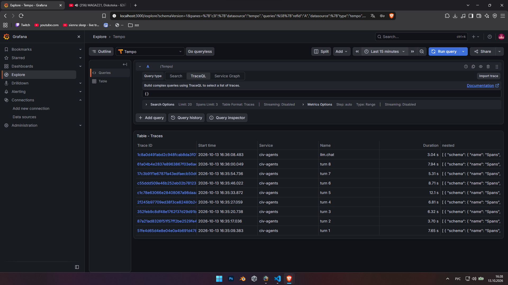
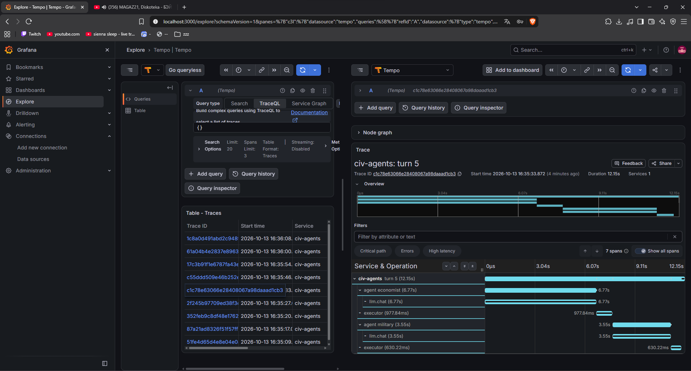
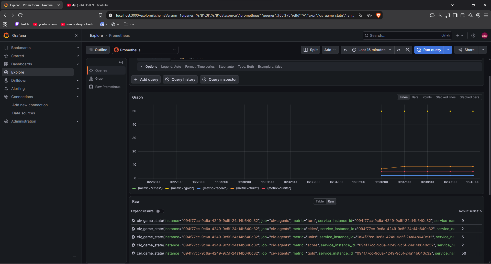
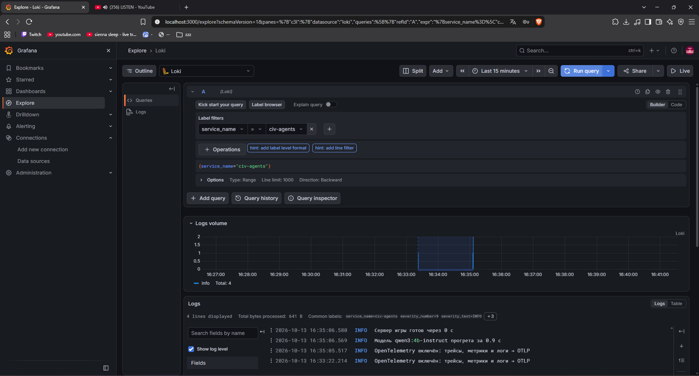
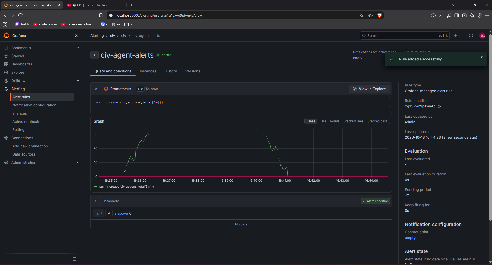

# Отчёт: мультиагентная система «Правитель Freeciv»

## 1. Что сделано

Система из нескольких LLM-агентов сама играет во Freeciv (открытый аналог Civilization): основывает города, исследует технологии, управляет юнитами. Под капотом — локальная open-source модель `qwen3:4b-instruct` в Ollama на ноутбучной RTX 3050 (4 ГБ). Подробное ТЗ — `docs/tz.md`.

| Пункт задания | Где в проекте |
|---|---|
| ТЗ | `docs/tz.md` |
| Изоляция | раздел 3, `compose.yaml` |
| Open-source LLM, локально | раздел 4, ADR 0002, `docs/benchmarks.md` |
| Архитектура МАС | раздел 5, `src/civ_agents/agents/` |
| Системные промпты | раздел 6, `agents/prompts.py` |
| Скиллы | раздел 7, `agents/skills.py`, `skills/*.md` |
| .md-файлы | раздел 7, `knowledge/*.md` |
| Память | раздел 8, `src/civ_agents/memory/` |
| Evals | раздел 9, `scripts/evals.py`, `scripts/eval_llm.py` |
| Observability | раздел 10, `src/civ_agents/observability/` |

Решения по ходу работы записаны в ADR (`docs/decisions/0001–0006`).

## 2. Как устроена система

```
            ┌──────────────── Docker ────────────────┐
            │  freeciv-web (сервер игры)              │
            │  ollama (qwen3:4b-instruct, GPU)        │
            │  otel-lgtm (Collector, Tempo, Loki,     │
            │             Prometheus, Grafana)        │
            └──────▲──────────────▲───────────▲──────┘
                   │ CivRealm     │ OpenAI API │ OTLP
┌──────────────────┴──────────────┴───────────┴────────────────────┐
│ civ_agents (Python)                                              │
│                                                                  │
│  env/      GameSession ─ состояние → сводка; действия → проверка  │
│  agents/   Government: Правитель → Советники → Исполнитель        │
│  memory/   эпизодическая · семантическая (BM25) · рефлексия       │
│  llm/      клиент модели: ретраи, дедлайн, очистка ответа         │
│  observability/ журнал вызовов, OTel, алерты                      │
└──────────────────────────────────────────────────────────────────┘
```

Цикл хода:
1. `GameSession` получает наблюдение CivRealm и строит `GameState` (игрок, города, юниты, технологии) и каталог допустимых действий.
2. Для каждой роли собирается компактная сводка (~200–700 токенов вместо десятков тысяч чисел карты).
3. Советники отвечают JSON-планом; план разбирается и проверяется по каталогу.
4. Исполнитель (код, не LLM) отправляет в игру только допустимые действия, затем завершает ход.

## 3. Изоляция

### Что сделано
- Сервер игры, модель и стек наблюдаемости — **в отдельных Docker-контейнерах**.
- Порты опубликованы **только на 127.0.0.1**: снаружи машины сервисы недоступны.
- Модели хранятся в volume: контейнер модели можно запускать **без доступа в интернет** (веса скачаны заранее).
- Агенты не выполняют сгенерированный моделью код: модель выбирает действия из закрытого списка, а исполнитель проверяет каждое. Это **изоляция на уровне действий**: даже «сошедшая с ума» модель не может сделать ничего, кроме допустимого игрового хода.

### Сравнение вариантов

| Вариант | Изоляция | Накладные расходы | GPU | На Windows/WSL2 | Вывод |
|---|---|---|---|---|---|
| Процесс в venv | нет (общее ядро, ФС, сеть) | нет | да | да | только для разработки |
| **Docker (runc)** | namespaces + cgroups, общее ядро | минимальные | да (NVIDIA toolkit) | **да** | **выбран** |
| gVisor (runsc) | свой «ядро в user space», перехват syscalls | заметные на I/O | ограниченно | частично | для кода, который пишет LLM |
| Kata Containers | лёгкая VM на контейнер | средние | сложно | нет (нужен KVM) | для мультиарендности |
| Firecracker | microVM, минимальное устройство | малые для VM | нет | нет (нужен KVM) | serverless, песочницы кода |
| Полная VM | полная | большие | проброс сложен | да (Hyper-V) | избыточна |
| WASM (Wasmtime) | песочница рантайма, capability-модель | малые | нет | да | для небольших плагинов, не для LLM-сервера |

### Почему Docker
- Нужен **GPU** для модели: из вариантов с сильной изоляцией GPU нормально работает только в Docker; Kata/Firecracker требуют KVM, которого нет в WSL2 на этом ноутбуке.
- Угроза в нашей системе — не выполнение чужого кода, а **некорректные действия модели**. Её закрывает исполнитель-валидатор, а не ядро.
- Docker даёт воспроизводимость (`compose.yaml`) и изоляцию сети/портов достаточного уровня.

### Если агент начнёт генерировать код
Например, «аналитик», пишущий Python для расчётов. Тогда этот код запускается в отдельном контейнере с `runtime: runsc` (gVisor), `network_mode: none`, read-only ФС и лимитами CPU/памяти; на Linux-сервере с KVM — в Firecracker microVM.

### Ограничения
Сам Python-процесс агентов сейчас запускается в WSL, а не в контейнере (CivRealm использует много портов клиента и проще отлаживается локально). Следующий шаг — контейнер агентов во внутренней сети compose (`internal: true`) только с доступом к ollama и freeciv-web.

## 4. Модель

`qwen3:4b-instruct` (Q4_K_M) в Ollama, OpenAI-совместимый API. Подробно — ADR 0002 и `docs/benchmarks.md`.

- Видеопамять: 4 ГБ, ~1,3 ГБ занимает Windows → модель с контекстом 8192 работает 20/80 CPU/GPU.
- Скорость: чтение промпта ~1160 ток/с, генерация ~15–18 ток/с; вызов 3–10 с.
- **Thinking против instruct:** тег `qwen3:4b` в Ollama указывает на thinking-модель; на вызове инструмента она тратит 514 токенов и 25,8 с против 35 токенов и 1,5 с у instruct при одинаковом результате. Выбрана instruct.
- Отвергнуты: vLLM (не для 4 ГБ), llama.cpp server (ручная работа с моделями), облачные модели (требование open-source).

## 5. Архитектура

### Выбранная: иерархия «правительство»
- **Правитель** — раз в 10 ходов задаёт стратегию (текст) и налоги.
- **Советники:** наука (по необходимости), экономист (поселенцы, рабочие, города), военный (разведчики, боевые юниты).
- **Исполнитель** — детерминированный код (`GameSession.act`): проверка каждого действия по каталогу CivRealm, отправка, конец хода.
- **Роутинг** — правилами: советник вызывается, только если у него есть кем командовать (нет городов — экономист не спрашивается о городах; исследование выбрано — наука молчит).

### Почему так
- **Бюджет времени:** 60 с на ход, вызов модели 3–10 с → 6–15 вызовов. На практике 2–4 вызова за ход, 5–11 с (замер на 10-ходовой партии).
- **Маленькая модель лучше справляется с узкой задачей:** каждый советник видит только свой срез (экономисту — города и окрестности поселенцев; учёному — технологии) и командует только своими юнитами (иначе действие отклоняется).
- **Исполнитель — код, а не LLM:** проверка допустимости — детерминированная задача; неверная команда в CivRealm (`E_BAD_COMMAND`) роняет всю партию.

### Альтернативы
| Архитектура | Плюсы | Минусы | Статус |
|---|---|---|---|
| **Один агент** (`--mode single`) | 1 вызов на ход, просто | длинный промпт, всё в одном контексте, маленькая модель путается | реализован, сравнивается в evals |
| **Иерархия** | узкие задачи, свои срезы, роутинг экономит вызовы | больше вызовов, согласование через стратегию | **основной вариант** |
| Blackboard | агенты асинхронно читают/пишут общее состояние | нужен арбитраж конфликтов, сложнее отлаживать | частично: общая «доска» — стратегия + события памяти |
| Дебаты | несколько мнений, меньше ошибок | ×2–3 вызовов, не помещается в бюджет на 4B-модели | не реализован |

## 6. Системные промпты

`agents/prompts.py`. Структура: общая часть (игра, цель, «только допустимые действия») → роль → заметки из базы знаний → формат ответа. Неизменная часть стоит первой, чтобы сервер переиспользовал кэш промпта (замер: вызов с кэшем в 3–4 раза быстрее).

Формат ответа — JSON: `{"actions": [{"type": "unit", "id": 101, "action": "build city"}]}`; у правителя есть поле `strategy`. Ответ разбирается и проверяется (`agents/schema.py`): терпимость к ```json и тексту вокруг, одиночное действие без обёртки. При ошибке модели возвращается текст ошибки с перечнем допустимого, один переспрос.

Пользовательское сообщение: текущая стратегия → последние события (память) → подсказки скиллов → сводка хода.

## 7. Скиллы и база знаний

### Скиллы (`agents/skills.py`, описания — `skills/*.md`)
Детерминированные параметризованные процедуры поверх состояния игры; их результат — подсказка в промпт, решение принимает модель, исполнение — `GameSession`.
- `city_site` («Основать город»): очки соседних клеток по местности и ресурсам → «build city» или «move <направление>».
- `research_plan` («Выбрать технологию»): следующая технология по проверенному порядку ранней игры.
- `assess_threat` («Оценить угрозу»): чужие юниты в окрестностях, города без защитника.
- `negotiate` («Переговоры»): описан; в первые 50 ходов контакта с соседями нет.

Почему скиллы — код: маленькая модель плохо считает очки клеток, а код делает это точно и дёшево; модель остаётся в роли принимающего решения.

### База знаний (`knowledge/*.md`)
`rules.md` (правила ранней игры), `strategy.md` (стратегия), `roles.md` (роли агентов), `lessons.md` (уроки прошлых партий, пополняется рефлексией). Используется семантической памятью.

## 8. Память

| Слой | Вид | Живёт | Что хранит | Реализация |
|---|---|---|---|---|
| Рабочая | краткосрочная | ход | сводка, стратегия, подсказки | промпт с бюджетом токенов по разделам |
| Эпизодическая | долгосрочная | партия | значимые события (основан/потерян город, новый юнит, изучена технология, контакт) | разница состояний между ходами → `events.jsonl`, последние 8 событий в промпт |
| Семантическая | долгосрочная | всегда | правила, стратегия, уроки | BM25 по фрагментам `.md` (без внешних зависимостей), 2 фрагмента до 900 символов |
| Рефлексия | долгосрочная | между партиями | 3 урока после партии | модель разбирает события и итог → `lessons.md` → находится поиском в следующей партии |

### Почему так
- Контекст 8192 токена: вся история не помещается → краткосрочная память — только самое нужное, долгосрочная — снаружи с поиском.
- События выводятся **кодом из разницы состояний**, а не пишутся моделью: дёшево и без галлюцинаций.
- BM25 вместо эмбеддингов: база знаний маленькая и терминологическая (Settlers, Grassland, Monarchy) — точное совпадение слов работает хорошо, не нужна вторая модель в 4 ГБ видеопамяти.

### Недостатки выбранного
- BM25 не понимает синонимов («основать поселение» ≠ «found city»).
- Эпизодическая память — линейный список; нет связей «событие → причина».
- Рефлексия может записать неверный урок; уроки не проверяются и копятся.
- Последние 8 событий — грубое окно; важное раннее событие выпадает.

### Альтернативы
| Подход | Суть | Плюсы | Минусы для нашего случая |
|---|---|---|---|
| Наивный RAG (эмбеддинги) | вектора фрагментов, косинус | синонимы | вторая модель в VRAM, для маленькой терминологической базы выигрыш мал |
| Гибридный RAG + rerank | BM25 + вектора + переранжирование | лучшее качество поиска | +латентность, +модель |
| GraphRAG | граф сущностей и связей | связи «город—угроза—юнит» | дорогое построение графа LLM-ом, избыточно для 50 ходов |
| MemGPT / Letta | модель сама управляет памятью (страницы, архив) | гибкость | много служебных вызовов, 4B-модель плохо управляет памятью |
| Mem0 | извлечение фактов из диалога в хранилище | готовый сервис | рассчитан на диалоги с пользователем, а не на состояние игры |

### Что улучшить
Гибридный поиск (BM25 + маленькие эмбеддинги на CPU), важность событий (не только последние), проверка уроков рефлексии на следующих партиях (оставлять только улучшившие счёт), граф событий для военного советника.

## 9. Evals

### Уровень LLM (`scripts/eval_llm.py` → `docs/evals_llm.md`)
- 12 вопросов по правилам Freeciv; проверка кодом по ключевым словам (без LLM-судьи — он сам ошибался бы на 4B).
- Два варианта: без памяти и с семантической памятью → прямой замер пользы RAG.
- Валидность JSON и доля допустимых действий — из реальных партий (метрики советников).

### Уровень системы (`scripts/evals.py` → `docs/evals_results.md`)
- Варианты: `random` (нижняя планка, как RandomAgent CivRealm), `single`, `hierarchy`, `hierarchy-nomem` (аблация памяти), `hierarchy-noskills` (аблация скиллов).
- Метрики: счёт, города, население, юниты, выживание; время хода (ср./макс.), вызовов LLM на ход, доля ошибок формата, доля недопустимых действий, токены на ход.
- Несколько партий на вариант, среднее ± разброс: между партиями большой разброс (базовая линия: ИИ Freeciv набирал 80–131 очков в разных партиях).
- Фиксированный горизонт (N ходов задаёт сессия): сервер сам завершает партию около 90-го хода, партии разной длины несравнимы.
- Внешние эталоны: случайный агент ~16–18 очков за ~90 ходов, встроенный ИИ 80–131.

### Как оценивать агентную систему вообще
Результат задачи (счёт), надёжность (выживание, падения), качество решений по шагам (доля допустимых действий, ошибки формата), стоимость (токены, время хода), устойчивость (разброс по партиям), вклад компонентов (аблации).

### Результаты (15 ходов, `docs/evals_results.md`)

| Вариант | Партий | Счёт | Города | Население | Время хода, с (ср / макс) | Вызовов на ход | Ошибки формата | Недопустимые действия | Токенов на ход |
|---|---|---|---|---|---|---|---|---|---|
| random | 2 | 3,0 ± 0 | 2,0 | 3,0 | — | — | — | — | — |
| single | 1 | 2,0 | 2,0 | 2,0 | 9,5 / **39,9** | 1,5 | **13%** | **48%** | 1853 |
| hierarchy | 1 | 2,0 | 1,0 | 2,0 | 6,5 / 14,8 | 2,4 | **0%** | 21% | 2590 |
| hierarchy-nomem | 1 | 4,0 | 2,0 | 4,0 | 6,8 / 11,1 | 2,5 | 3% | **14%** | 2278 |

Все варианты выжили. Недопустимые действия — те, что отклонил исполнитель **до** отправки в игру: в саму игру не попало ни одного.

**Что видно:**
1. **Качество решений: иерархия заметно лучше одного агента.** Доля недопустимых действий снизилась с 48% до 14–21%, ошибки формата — с 13% до 0–3%, самый долгий ход — с 40 с до 11–15 с. Причина в том, что у советника короткий промпт про свой срез и узкий список действий, а одиночный агент видит всё сразу, путается в id и чаще уходит в переспрос. Это главный аргумент за выбранную архитектуру.
2. **Цена иерархии** — примерно в 1,6 раза больше вызовов (2,4 против 1,5) и на 25–40% больше токенов на ход. При этом ход всё равно короче: вызовы у советников быстрые, переспросов меньше.
3. **По счёту различий нет.** Счёт 2–4, разница в пределах шума. За 15 ходов очки Freeciv почти не растут (они идут в основном от граждан и технологий), а случайный агент тоже строит 2 города: стартовые поселенцы стоят на годных клетках. Сказать, что агент «играет лучше random», эти данные не позволяют.
4. **Память не дала выигрыша** (без памяти счёт 4 против 2, но это по одной партии). Возможные причины: на 15 ходах ещё нечего вспоминать; заметки из базы знаний (~300 токенов на ход) отнимают внимание у 4B-модели; в партии с памятью экономист поставил только один город. Для честного вывода нужны длинные партии.

**Ограничения:** по 1–2 партии на вариант и короткий горизонт — время на одном ноутбуке (партия на 15 ходов идёт около 3–5 минут, плюс одна партия single потерялась при зависании WSL). Чтобы вывод по счёту стал значимым, нужно 50 ходов × 5+ партий на вариант с фиксированными сидами и сравнение средних с доверительным интервалом. Скрипт это поддерживает (`--turns 50 --games 5`), упирается только во время.

### Результаты уровня LLM (`docs/evals_llm.md`)

| Вариант | Верных из 12 | Доля |
|---|---|---|
| Без памяти | 3 | 25% |
| С семантической памятью (BM25 по `knowledge/`) | 10 | 83% |

Своих знаний о правилах Freeciv у 4B-модели почти нет: она путает их с Civilization и выдумывает числа. Поиск по базе знаний поднимает точность с 25% до 83%, то есть сам механизм RAG работает.

**Оговорка:** вопросы и база знаний написаны одним автором, поэтому формулировки близки и BM25 находит нужный фрагмент легко. Это оптимистичная оценка. Честнее был бы набор вопросов, составленный независимо по вики Freeciv.

**Почему польза есть здесь и нет в партиях.** Знание правил не узкое место первых 15 ходов: что делать (строить город, исследовать, разведывать), подсказывают скиллы и список допустимых действий. Память должна окупаться позже, когда появятся соседи, недовольство в городах и смена правительства. Проверка — аблация на длинных партиях.

## 10. Observability

### Что настроено
- **Журнал вызовов модели** (`runs/<id>/llm_calls.jsonl`, всегда): агент, ход, токены (включая кэш), время, попытки, ошибка; сводка `python -m civ_agents.observability.summary runs/<id>` (p50/p95, самый медленный вызов, по агентам).
- **Трейсы** (OpenTelemetry → Tempo): `turn N → agent <роль> → llm.chat`, `executor`. Контекст хода/агента передаётся через `ContextVar`, клиент модели об агентах не знает.
- **Метрики** (OTel → Prometheus): `civ_llm_calls`, `civ_llm_latency`, `civ_llm_tokens`, `civ_turn_duration`, `civ_actions`, `civ_game_state` (города, юниты, счёт, золото), `civ_alerts`.
- **Логи** (OTel → Loki): логи `civ_agents`, включая WARNING алертов.
- **Алерты** (`observability/alerts.py`, после каждого хода): ход > 80% бюджета; ошибки модели; доля недопустимых действий > 30%; ход без действий. Пишутся в `alerts.jsonl`, лог и метрику; в Grafana на `civ_alerts` вешается уведомление.
- **Состояние партии:** `turns.jsonl`, `actions.jsonl`, `events.jsonl`, `game_results.json`, снимок настроек `config.yaml`.

### Как это выглядит (партия на 8 ходов, `CIV_OTEL=1`)

**Трейсы (Tempo):** один трейс на ход, отдельный трейс `llm.chat` для рефлексии после партии.


**Трейс самого долгого хода (turn 5, 12,15 с):** экономист 6,77 с (весь вызов модели), военный 3,55 с, исполнитель 0,6–1 с. Агенты вызываются последовательно; распараллеливать их бессмысленно, потому что Ollama на 4 ГБ обслуживает один запрос за раз (`NUM_PARALLEL=1`). Ускорить ход можно только сократив промпт или ответ экономиста — это видно сразу по трейсу.


**Метрики (Prometheus):** `civ_game_state` — ход, города, юниты, счёт, золото по ходу партии.


**Логи (Loki):** логи `civ_agents` с уровнем, привязанные к сервису.


**Правило алерта (Grafana Alerting) «агент завис»:** `sum(increase(civ_actions_total[5m]))` ниже 1 — за 5 минут агент не отправил в игру ни одного действия (зависла модель, сервер игры или цикл). Оценка раз в минуту, pending 1 мин; при отсутствии данных (партия не идёт) — Normal. Дополняет алерты внутри процесса (`alerts.py`): те ловят проблемы конкретного хода, этот — остановку целиком, даже если процесс агента упал и сам ничего сообщить не может.


### Сравнение стеков
| Стек | Плюсы | Минусы | Решение |
|---|---|---|---|
| **grafana/otel-lgtm** (Collector + Tempo + Loki + Prometheus + Grafana в одном контейнере) | один контейнер, стандарт OTLP | не для продакшна | **выбран** (ноутбук, 1 человек) |
| Отдельно Prometheus + Grafana + Loki + Jaeger | гибко, продакшн-вариант | 4–5 контейнеров, RAM | описан как продакшн-вариант |
| Langfuse / Phoenix | LLM-специфичные трейсы, просмотр промптов | ещё один сервис с БД | промпты и так в `llm_prompts.jsonl` |
| Только JSONL | ноль инфраструктуры | нет дашбордов и алертов | оставлен как основной «чёрный ящик» |

Не настроено: метрика видеопамяти (нужен экспортер на основе `nvidia-smi`; DCGM-экспортер на ноутбучной карте может не работать).

## 11. Итоги и ограничения
- Работает: полные партии агентами в бюджете времени (5–11 с на ход), ноль недопустимых действий, дошедших до игры, память и рефлексия, телеметрия.
- По evals: иерархия выигрывает у одного агента по качеству решений (недопустимых действий 14–21% против 48%, ошибок формата 0–3% против 13%), но на 15 ходах по счёту не отличается ни от одного агента, ни от random.
- Ограничения: 4B-модель на 4 ГБ, горизонт ранней игры, агент вне контейнера, оценки на малом числе партий.
- Найдено по ходу: thinking-тег в Ollama, сброс колб при повторном выборе исследования, обрыв партии сервером на ~90-м ходу, поведение `LLMWrapper`, ломающего действия науки.
